# BookingPT

[](https://github.com/DoTu202/BookingPT/actions/workflows/ci.yml)

BookingPT is a mobile app (iOS and Android) that connects freelance personal trainers with clients. Clients search for a trainer, book one of the trainer's open time slots, chat with them and review the session afterwards. Trainers publish their availability, handle booking requests and follow their earnings and activity on a dashboard.

I designed and built the whole project on my own: the React Native app, the Node.js API, the MongoDB data model, the realtime and push infrastructure, the tests and the CI pipeline. The app's interface is in Vietnamese and is built for users in Vietnam.

**Stack:** React Native 0.79 (New Architecture) · Redux Toolkit · React Navigation 7 · Node.js 20 · Express 5 · MongoDB / Mongoose 8 · Socket.IO 4 · Firebase Cloud Messaging · Jest · GitHub Actions

---

- [Screenshots](#screenshots)
- [What the app does](#what-the-app-does)
- [Skills demonstrated](#skills-demonstrated)
- [Technical problems I solved](#technical-problems-i-solved)
- [Architecture](#architecture)
- [Running it locally](#running-it-locally)
- [Project structure](#project-structure)
- [Tests](#tests)
- [Documentation](#documentation)
- [What I would build next](#what-i-would-build-next)

## Screenshots

**Client**

| Sign in | Home | Menu | Notifications |
| :---: | :---: | :---: | :---: |
| 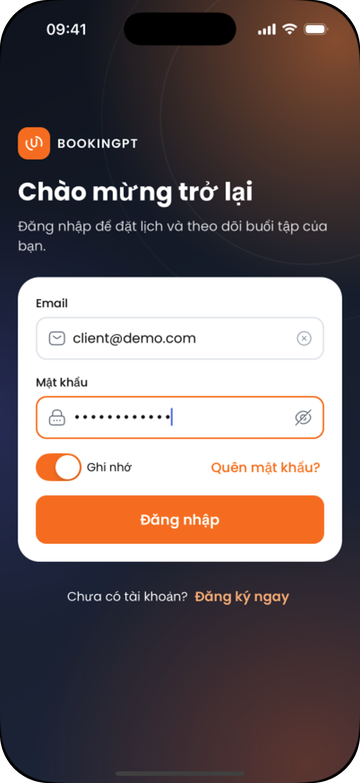 | 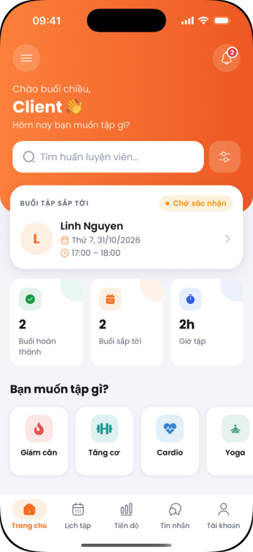 | 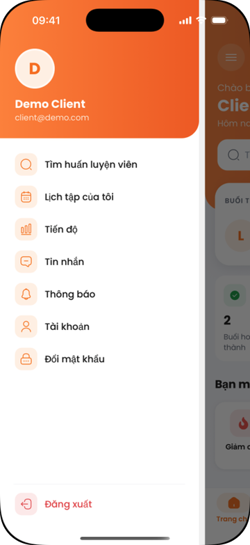 | 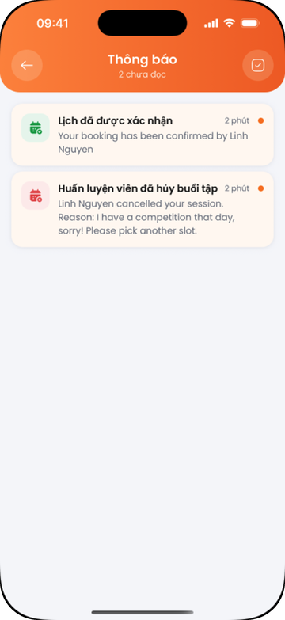 |
| **My bookings** | **Progress** | **Messages** | **Profile** |
| 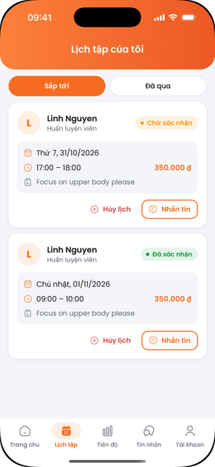 | 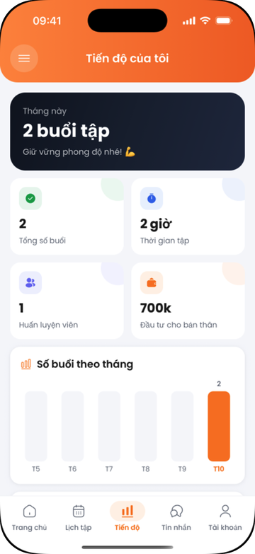 | 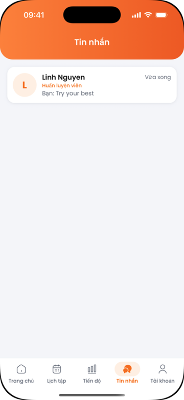 | 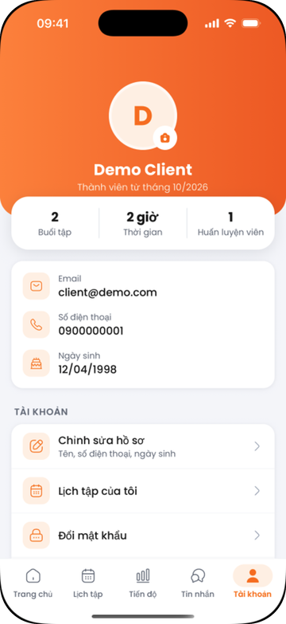 |

**Trainer**

| Home | Booking requests | Availability | Public profile |
| :---: | :---: | :---: | :---: |
| 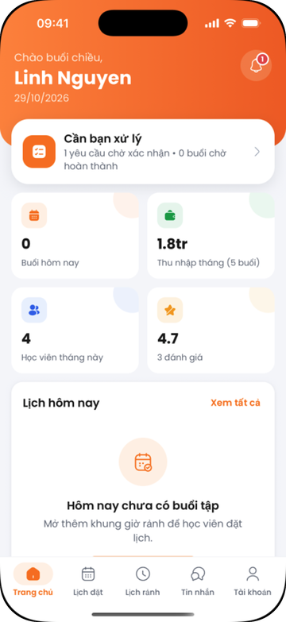 | 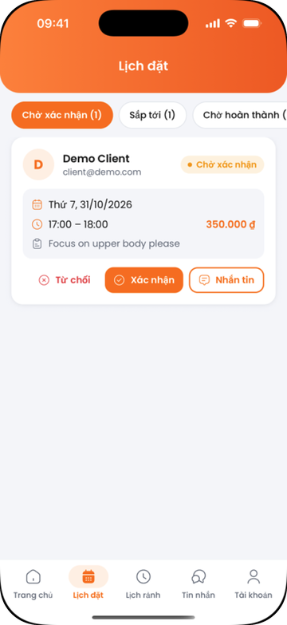 | 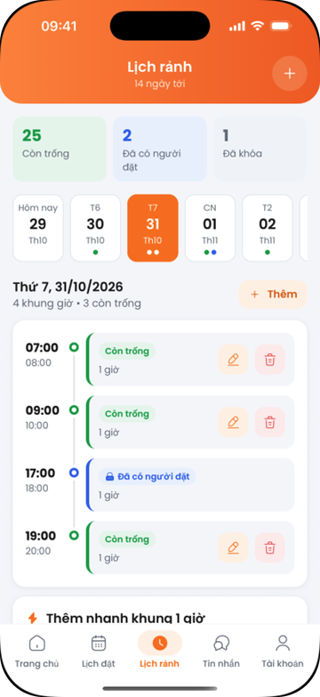 | 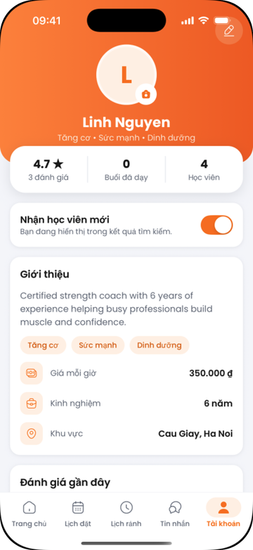 |

## What the app does

**Clients**
- Search trainers by name, specialization, area, price range and available date; sort by price or experience.
- Open a trainer's profile with real ratings and reviews, pick an open slot and send a booking request with a note.
- Cancel a request, or a confirmed session up to 24 hours before it starts.
- Chat with trainers in real time (typing indicator included).
- Get notified when a request is confirmed, rejected or cancelled, and 24 hours before each session.
- Review completed sessions; see monthly progress, hours trained, spending and session history.

**Trainers**
- Plan availability for the next 14 days: per-day timeline, one-tap 1-hour slots, edit and delete free slots.
- Confirm or reject requests (with an optional reason), cancel confirmed sessions (reason required), mark sessions as completed.
- Dashboard by week, month or year: earnings compared with the previous period, completed sessions and hours, completion and cancellation rates, share of open slots that got booked, busiest weekdays, top clients and rating distribution.
- Manage a public profile: bio, specializations, hourly rate, area, photo, and whether new clients are accepted.

**Accounts**
- Sign-up with email verification code, password reset, email change with verification, profile photo upload.
- "Sign out of all devices" and account deletion.

## Skills demonstrated

| Area | What I did | Where to look |
| --- | --- | --- |
| Mobile development | Two role-based navigation flows (drawer + tabs for clients, tabs for trainers), 23 screens, session persistence, optimistic UI, pull-to-refresh, empty/error/loading states everywhere | [`clients/src/navigators`](clients/src/navigators), [`clients/src/screens`](clients/src/screens) |
| UI engineering | A small design system (color and spacing tokens, shared components), collapsing headers, SVG gradients and charts built without UI or chart libraries, safe-area and notch handling, font-scaling limits | [`components`](clients/src/components), [`HeroScrollView`](clients/src/components/layout/HeroScrollView.jsx), [`BarChart`](clients/src/components/charts/BarChart.jsx) |
| Backend design | Layered Express API (routers, controllers, services, models), central error handling, input validation, structured logging with request ids | [`server/src`](server/src), [`app.js`](server/src/app.js) |
| Data modeling | 10 MongoDB collections with indexes, a TTL index for one-time codes, derived fields (trainer rating) kept consistent through one function | [`server/src/models`](server/src/models), [`reviewService`](server/src/services/reviewService.js) |
| Concurrency | Booking and every status change are conditional atomic updates; concurrent requests can't both succeed | [`bookingService`](server/src/services/bookingService.js) |
| Realtime | Socket.IO gateway with JWT handshake, per-user rooms, typing events with membership checks and throttling, reconnect catch-up on the client | [`realtimeService`](server/src/services/realtimeService.js), [`socketClient`](clients/src/apis/socketClient.js) |
| Push notifications | FCM on server and app, token lifecycle (register, move between accounts, prune dead tokens, revoke on sign-out), deep links from a notification tap | [`pushService`](server/src/services/pushService.js), [`pushNotifications`](clients/src/utils/pushNotifications.js) |
| Analytics | Dashboard statistics computed with MongoDB aggregation pipelines, bucketed per day or month in the local time zone | [`dashboardService`](server/src/services/dashboardService.js) |
| Security | JWT with server-side revocation, hashed one-time codes with expiry and attempt limits, rate limiting, NoSQL-injection and ReDoS protection, upload content checks, log redaction | [`authMiddleware`](server/src/middleware/authMiddleware.js), [`otpService`](server/src/services/otpService.js) |
| Testing | 76 integration tests against an in-memory MongoDB, including concurrency, a real Socket.IO server and a fake FCM transport; 44 unit, hook and component tests in the app | [`server/tests`](server/tests), [`clients/__tests__`](clients/__tests__) |
| Tooling | GitHub Actions (lint, tests, `npm audit`), Docker Compose for the API and database, seed and test-account scripts | [`.github/workflows/ci.yml`](.github/workflows/ci.yml), [`docker-compose.yml`](docker-compose.yml) |

## Technical problems I solved

**1. Two clients booking the same slot at the same time.**
Checking "is the slot free?" and then saving the booking leaves a gap where a second request can get in. Booking now reserves the slot with a single `findOneAndUpdate` whose filter includes `status: 'available'`, so MongoDB lets exactly one request through. Every later status change (confirm, reject, cancel, complete) is also a conditional update on the expected current status and time rules. When an update matches nothing, the service reloads the booking to return the precise reason: 404, 403, 400, or 409 if another request changed it first. The tests send concurrent requests and assert that exactly one wins.

**2. Signing a user out everywhere when JWTs are stateless.**
A JWT stays valid until it expires, so changing a password used to leave other devices signed in. The auth middleware now rejects tokens issued before `passwordChangedAt` or `tokensValidAfter`. Password change, password reset, "sign out of all devices" and account deletion also close the user's open WebSocket connections and delete their push tokens, so a signed-out phone stops receiving messages too. The device that changed the password gets a fresh token and stays signed in.

**3. Dates in Vietnam time, storage in UTC.**
Sessions are stored in UTC, but "today", "this week" and the dashboard charts have to follow Vietnam time (UTC+7). A session at 00:30 on Monday in Vietnam is still Sunday in UTC, so naive date handling put it in the wrong week. Day filters on the server use a helper that converts a Vietnam calendar day to UTC bounds; the dashboard groups with `$dateToString` in the `Asia/Ho_Chi_Minh` time zone and starts weeks on Monday; the app converts picker input and display times through one module. The edge cases are covered by tests with a fixed clock.

**4. Realtime chat without a second write path.**
I kept all writes on the REST API, where validation, authorization and rate limiting already live, and used Socket.IO only to push events. The app shows a sent message immediately with a temporary id, sends that id with the request, and the server echoes it back in the socket event so the app replaces the pending bubble instead of showing a duplicate. Each screen refetches on reconnect, so messages missed while the phone was offline still appear.

**5. Dashboard numbers that were wrong for busy trainers.**
The first version counted earnings on the phone from the trainer's booking list, which the API caps at 200 items. I moved the statistics to the server as aggregation pipelines (twelve queries run in parallel), so the result is correct regardless of history size, and the trainer home screen reuses the same endpoint.

**6. React Native New Architecture issues.**
`react-native-linear-gradient` runs through the compatibility layer under the New Architecture and drew its gradient inset when it had padding, leaving a white band under the iPhone notch. I replaced it with a small SVG-based gradient component and removed the library. Separately, Metro's inline requires meant a date-library plugin registered in one module wasn't loaded yet when another screen rendered first, which crashed that screen. I moved the date setup into one module that every file imports.

## Architecture

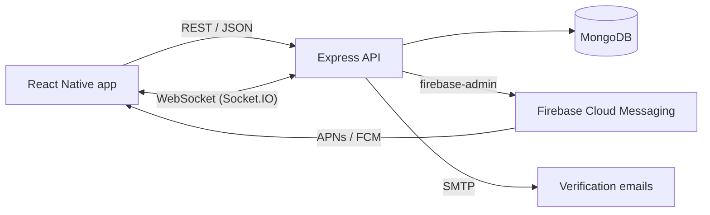

- The API is layered: routers, thin controllers, services that hold the business rules, and Mongoose models. Services never touch `req`/`res`, which keeps them testable and reusable from background jobs.
- Booking status changes happen in one service, following an explicit state diagram.
- Background jobs expire unanswered requests, send reminders and complete past sessions. Each job claims a booking with a conditional update, so several server instances can run them safely.
- Push notifications are optional on both sides: without Firebase credentials the app and API run normally.

Diagrams of the data model, booking lifecycle, chat and push flows are in [docs/architecture.md](docs/architecture.md).

## Running it locally

Requirements: Node.js 20+, MongoDB or Docker, and Xcode and/or Android Studio.

```bash
git clone https://github.com/DoTu202/BookingPT.git
cd BookingPT

# API and database (http://localhost:3001)
docker compose up --build
# or without Docker: cd server && cp .env.example .env && npm install && npm run dev

# Demo data. This deletes everything in the configured database...
cd server && npm run seed
# ...or keep existing data and only (re)create the demo accounts:
# npm run seed -- --append

# Mobile app
cd ../clients
npm install
bundle install && (cd ios && bundle exec pod install)   # iOS only
npm run ios        # or: npm run android
```

Demo accounts (password `Password123!`):

| Email | Role |
| --- | --- |
| `client@demo.com` | Client with bookings in each state, a conversation and notifications |
| `pt@demo.com` | Trainer with requests, open slots, completed sessions and reviews |

Running on a physical phone, environment variables, deployment and troubleshooting: [docs/development.md](docs/development.md). Enabling push notifications: [docs/push-notifications.md](docs/push-notifications.md).

## Project structure

```text
BookingPT/
├── clients/                 React Native app
│   ├── src/apis/            HTTP client, per-domain API modules, Socket.IO client
│   ├── src/components/      shared UI components (ui, layout, feedback, charts, domain, navigation, brand)
│   ├── src/hooks/           data loading, pagination, chat / photo / sign-out hooks
│   ├── src/constants/       colors, spacing, labels
│   ├── src/navigators/      auth, client and trainer navigation
│   ├── src/redux/           session state
│   ├── src/screens/         auth, client, trainer and shared screens (+ each group's components/)
│   ├── src/utils/           session, dates, formatting, push, dashboard helpers
│   └── __tests__/           unit tests
├── server/                  Express API
│   ├── src/routers/         URL to controller, auth and rate limits per route
│   ├── src/controllers/     request validation and response shaping
│   ├── src/services/        business logic, realtime, push, jobs
│   ├── src/models/          Mongoose schemas
│   ├── src/middleware/      auth, errors, rate limits, input sanitizing, uploads
│   ├── scripts/             seed and test-account scripts
│   └── tests/               integration tests
├── docs/                    architecture, API, development and push guides
└── docker-compose.yml
```

## Tests

```bash
cd server && npm test     # 76 integration tests; uses an in-memory MongoDB, no setup needed
cd clients && npm test    # 44 unit, hook and component tests
npm run lint              # in either folder
```

The server tests go through the real Express app: authentication and verification codes, the booking lifecycle including concurrent requests, reviews, background jobs, profile changes and token revocation, chat and search, dashboard statistics with a fixed clock, availability, push delivery and Socket.IO events. CI runs lint, tests and `npm audit` for both projects on every pull request.

## Documentation

- [Architecture](docs/architecture.md): system design, data model, booking states, realtime and push flows, security, testing approach
- [API reference](docs/api.md): every endpoint, error format, rate limits, dashboard payload, socket events
- [Development guide](docs/development.md): setup, environment variables, scripts, deployment, troubleshooting
- [Push notifications](docs/push-notifications.md): Firebase and APNs setup

## What I would build next

- Online payment for sessions
- Recurring availability (for example "weekdays 7–9 am")
- Workout plans and progress photos shared between trainer and client
- Unread counters and read receipts in chat
- An admin panel to verify trainers

## Contact

Đỗ Minh Tú · mhtu1213@gmail.com · [github.com/DoTu202](https://github.com/DoTu202)
