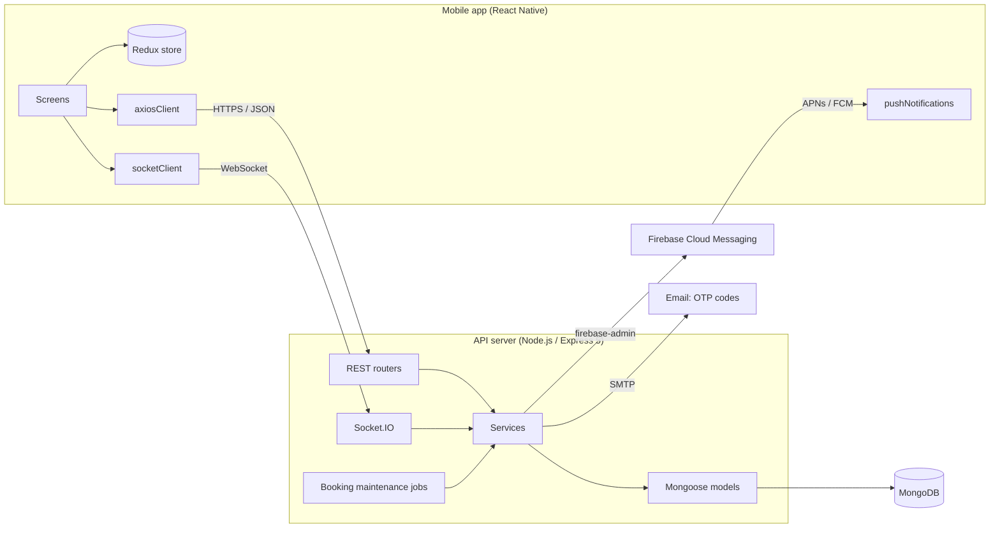
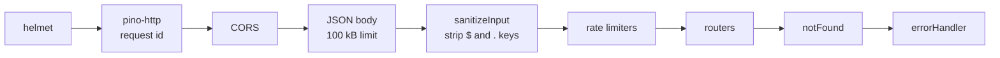
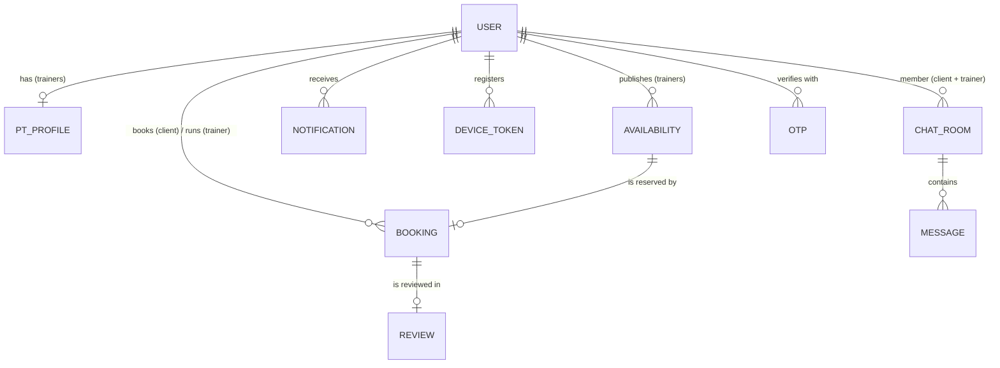
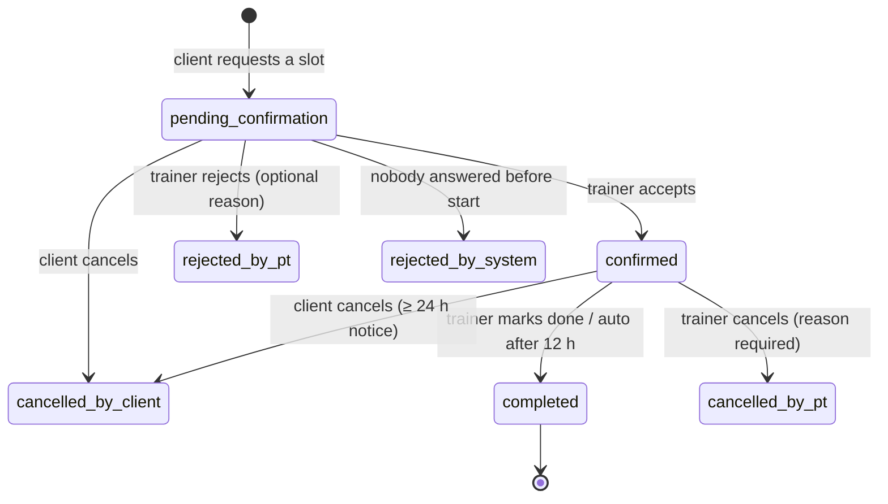
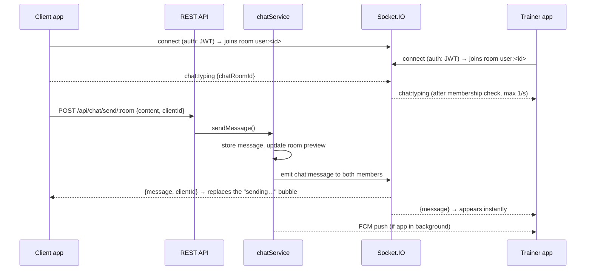
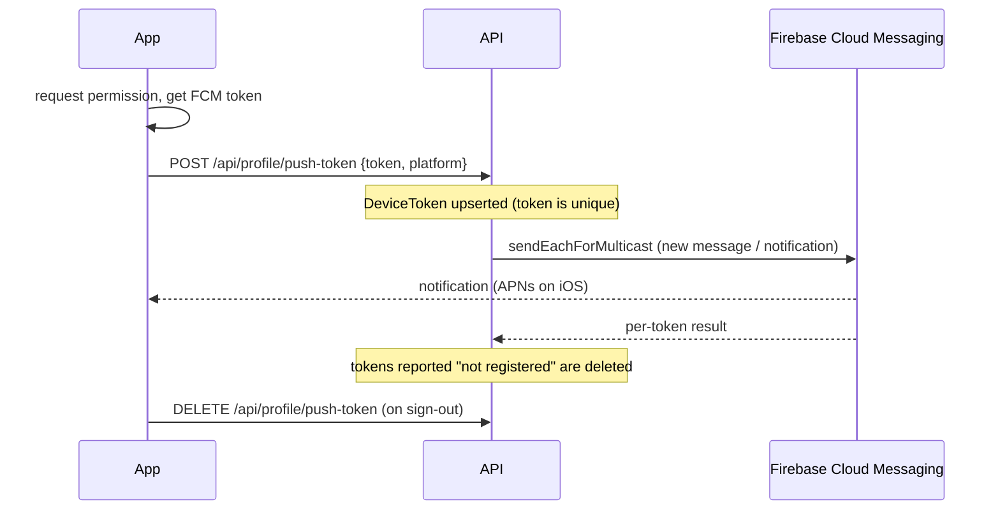
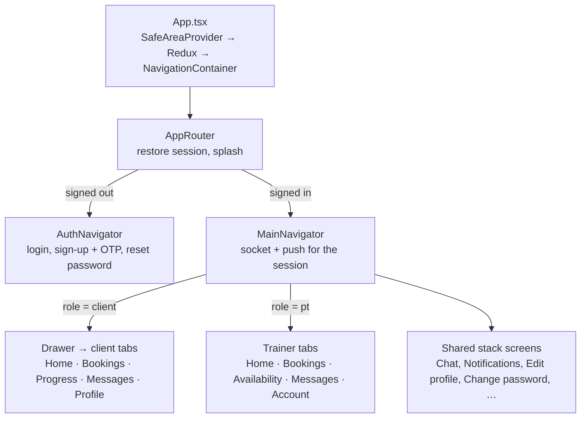

# Architecture

This document explains how BookingPT is put together and why. For setup and the API reference, see [development.md](development.md) and [api.md](api.md).

- [System overview](#system-overview)
- [Backend](#backend)
- [Data model](#data-model)
- [Booking lifecycle](#booking-lifecycle)
- [Realtime chat](#realtime-chat)
- [Push notifications](#push-notifications)
- [Mobile app](#mobile-app)
- [Time zones](#time-zones)
- [Security](#security)
- [Testing strategy](#testing-strategy)

## System overview

Two independent npm projects live in this repository:

| Folder | What | Stack |
| --- | --- | --- |
| [`clients/`](../clients) | iOS / Android app | React Native 0.79 (New Architecture), React 19, Redux Toolkit, React Navigation 7, Socket.IO client, React Native Firebase |
| [`server/`](../server) | REST API + realtime gateway | Node.js 20, Express 5, Mongoose 8 / MongoDB, Socket.IO 4, firebase-admin, pino, Jest |

Writes always go through the REST API. The WebSocket channel is **push-only**: the server uses it to tell clients that something changed. This keeps validation, authorization and rate limiting in one place and lets the app work (with polling-free refetches) even when the socket is down.

## Backend

### Request pipeline

`index.js` connects to MongoDB, starts the HTTP server, attaches Socket.IO, schedules the maintenance jobs and handles graceful shutdown. `src/app.js` builds the Express app (exported on its own so tests can use it without a network port).

### Layers

| Layer | Folder | Responsibility |
| --- | --- | --- |
| Routers | `src/routers` | URL → controller, per-route auth (`authenticateToken`, `authorizeRoles`) and rate limits |
| Controllers | `src/controllers` | Read and validate input, call a service, shape the JSON response. No business rules. |
| Services | `src/services` | Business logic, no `req`/`res`. Bookings, chat, reviews, notifications, push, realtime, dashboard, OTP, mail, tokens. |
| Models | `src/models` | Mongoose schemas and indexes |
| Utils | `src/utils` | `httpError` helpers, validators, date helpers (`dayRange` in Vietnam time), image signature checks |

Errors are thrown, not returned: `badRequest()`, `forbidden()`, `notFound()`, `conflict()` from `utils/httpError.js` carry a status code, and a single `errorHandler` turns every error (including Mongoose `CastError`, `ValidationError`, duplicate keys and Multer errors) into `{success: false, message}`. In production 5xx details and stack traces are hidden.

### Background jobs

`src/services/bookingMaintenance.js` runs every 5 minutes:

| Job | What it does |
| --- | --- |
| `expireStaleBookings` | Requests nobody answered before the session started → `rejected_by_system`, slot re-opened |
| `sendBookingReminders` | One reminder to both sides within 24 h of a confirmed session (tracked by `reminderSentAt`) |
| `autoCompleteBookings` | Confirmed sessions that ended 12 h+ ago → `completed` |

Each job claims a booking with a conditional update, so running several server instances never processes a booking twice.

## Data model

| Model | Notes |
| --- | --- |
| `User` | `role: client \| pt`; password `select: false`; `passwordChangedAt` and `tokensValidAfter` revoke old JWTs |
| `PTProfile` | Bio, specializations, rate, location. `rating` / `numReviews` are **derived** from reviews (`refreshPtRating`), never set directly |
| `Availability` | A bookable time slot: `available → booked`, or `unavailable_by_pt` after a trainer cancellation |
| `Booking` | Copies the slot times and price at booking time; status machine below |
| `Review` | One per completed booking, by its client |
| `ChatRoom` / `Message` | One room per client–trainer pair; `lastMessage` preview for the inbox |
| `Notification` | In-app notifications (also pushed) |
| `DeviceToken` | FCM token per app install, moves to the last user who signs in on that device |
| `Otp` | Hashed one-time codes with TTL index (sign-up, password reset, email change) |

## Booking lifecycle

`src/services/bookingService.js` is the only place a booking changes status.

**No double booking, no lost updates.** Creating a booking flips its slot `available → booked` with a single `findOneAndUpdate` whose filter includes `status: 'available'`; only one of two concurrent requests can match. Every status transition is also a conditional update that includes the expected current status and time rules in the filter (`applyTransition`). If nothing matches, the service reloads the booking to answer precisely: 404, 403, 400, or **409** when another request got there first. Integration tests fire concurrent requests to prove it.

Slot side effects: rejection, client cancellation and expiry re-open the slot; a trainer cancellation blocks it (`unavailable_by_pt`) until the trainer edits it. Booked slots can't be edited or deleted.

## Realtime chat

- **Authentication** – the handshake token is checked by the same `userFromToken` as REST (expired, revoked and deactivated accounts are refused).
- **Rooms** – each socket joins `user:<id>`, so services can address users, not sockets (`emitToUsers`). It works with several devices per user.
- **Optimistic UI** – the app shows the message immediately with a temporary id and sends it as `clientId`; the server echoes it back so the app can swap the bubble without duplicates.
- **Catch-up** – the app fires a local `'connect'` event on every (re)connect; screens refetch what they missed while offline or in the background.
- **Revocation** – changing or resetting a password, "sign out of all devices" and account deletion call `disconnectUser(userId)`.

## Push notifications

- **Optional by design.** Without `FIREBASE_SERVICE_ACCOUNT` (server) or the Firebase config files (app), push is a no-op and everything else works.
- Every in-app notification and every chat message is pushed to its recipient. Sending never blocks or fails the request that triggered it.
- Tapping a notification opens the chat or the notifications screen (`navigationRef.navigateWhenReady`, which also works from a cold start).
- In the foreground the OS shows nothing — the socket already updated the screen.

Setup guide: [push-notifications.md](push-notifications.md).

## Mobile app

| Concern | How |
| --- | --- |
| State | Redux Toolkit holds the session. "Remember me" keeps a copy in AsyncStorage; `utils/session.js` keeps both in sync and is the only way to sign out. |
| API | One `axiosClient`: attaches the token, signs out on 401, and turns every failure into an `Error` with a **Vietnamese** message (server messages are translated in `utils/errorMessage.js`). |
| Realtime | `apis/socketClient.js`: one socket per session, `useSocketEvent(event, handler)` hook for screens. |
| Design system | Tokens in `constants/appColors.js` and `constants/theme.js`; SVG-based `GradientView`; shared components in `components/` grouped as `ui/` (Card, Banner, Tag, ListItem, …), `layout/` (Screen, ScreenHeader, collapsing HeroScrollView, BottomSheet, Dialog, …), `feedback/` (StateView, AsyncView), `charts/`, `domain/` (BookingCard, PtItem, …). |
| Screen structure | Screens compose shared components; pieces used by one screen group live in that group's `components/` folder (e.g. `screens/ptScreen/components/dashboard`). Request state comes from `hooks/useAsync` / `hooks/usePaginatedList` instead of hand-written status/error/refreshing state. |
| Charts | Built from Views and `react-native-svg` — no chart library. |
| Language | Vietnamese UI; API codes mapped to labels in `constants/labels.js`. |

## Time zones

All instants are stored and transferred in UTC. Everything a person sees or picks is Vietnam time (`Asia/Ho_Chi_Minh`, UTC+7):

- **Server** – "a day" in filters (`?date=2026-10-15`) means a calendar day in Vietnam (`dayRange`). Dashboard buckets use MongoDB's `$dateToString` with the Vietnam time zone, and weeks start on Monday.
- **App** – `utils/timeUtils.js` converts picker input to UTC ISO strings and back; `YYYY-MM-DD` keys are built with dayjs in UTC+7, never with `toISOString()` (which is the UTC day).

Tests cover the edge cases, e.g. a session at 00:30 on Monday in Vietnam, which is still Sunday in UTC.

## Security

| Area | Measure |
| --- | --- |
| Passwords | bcrypt, shared minimum length rule on server and app |
| Sessions | JWT (HS256). Tokens issued before a password change, reset or "sign out of all devices" are rejected; open sockets and push tokens are revoked at the same time |
| Accounts | Email verified with a 6-digit OTP: hashed, 10-minute expiry, 5 attempts, 60 s resend cooldown, never returned by the API |
| Input | Body/param keys with `$` or `.` stripped (NoSQL injection), regex input escaped (ReDoS), ids validated (400 instead of 500), 100 kB body limit |
| Abuse | Rate limits: 500 req / 15 min per IP, 10 login attempts / 15 min, 5 email sends / 15 min |
| Uploads | MIME allow-list, extension chosen by the server, magic-byte check of the saved file |
| Privacy | Public trainer endpoints never expose email, phone or date of birth |
| Transport | `helmet` headers; release builds require an HTTPS API |
| Logs | Authorization headers and password/code fields are redacted |

## Testing strategy

- **Server** – Jest + Supertest integration tests against an in-memory MongoDB (`mongodb-memory-server`): auth and OTP flows, booking lifecycle and concurrency, reviews and maintenance jobs, profile and token revocation, chat and search, dashboard statistics (fixed clock, Vietnam time edge cases), availability ranges, push delivery (fake FCM transport) and realtime events over a real Socket.IO connection.
- **App** – Jest unit tests for pure logic: validators, time conversion, formatting, error translation, dashboard labels, the auth reducer.
- **CI** – GitHub Actions runs lint, tests and `npm audit` for both projects on every pull request.
